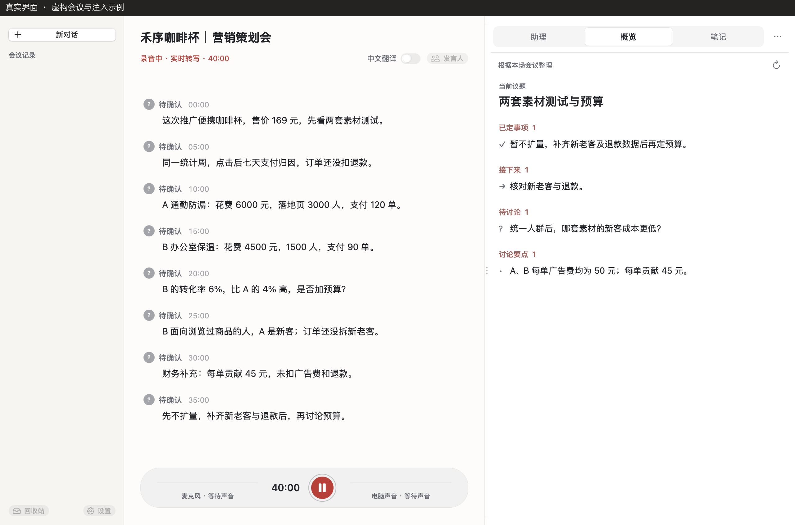
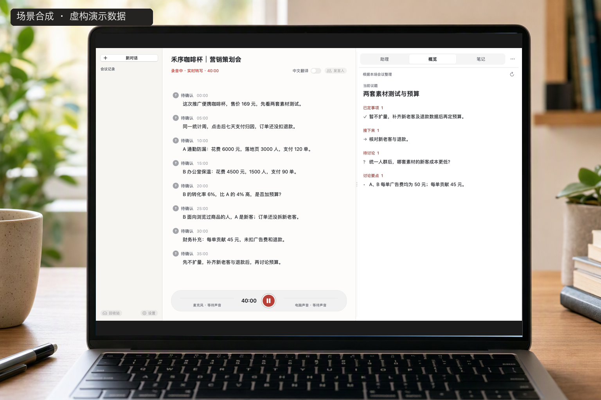
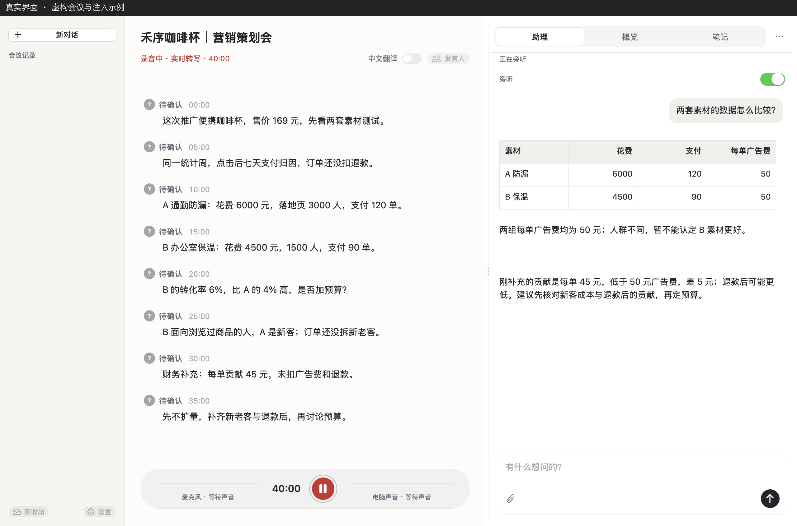
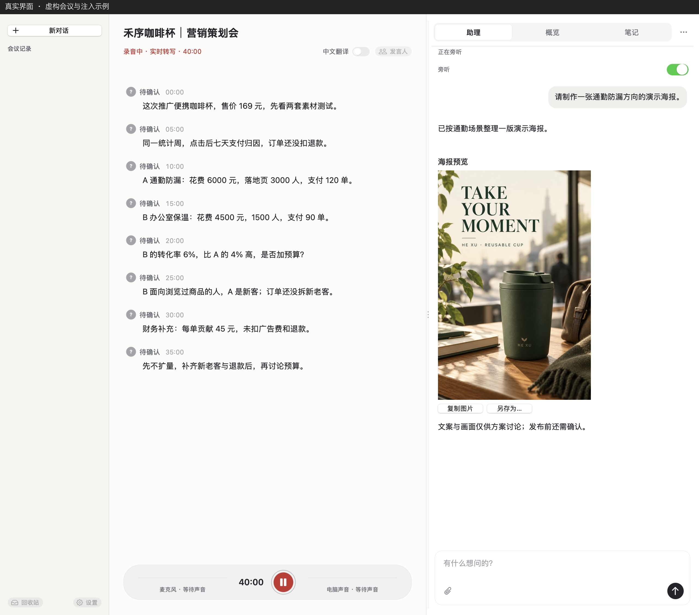

<p align="center">
  
</p>

<h1 align="center">在场 · Zaichang</h1>

<h3 align="center">别人的会也能留下原文；开会时，随时有外脑在场。</h3>

<p align="center">给常被拉进腾讯会议、微信语音，又要在当场把事情说清楚的人。<br>一场突然的会，从你的 Mac 留下原文；正在开的会，问题和提醒留在同一场对话里。</p>

<p align="center">
  <a href="docs/AGENT_SETUP.md"><strong>让 Agent 帮我安装 →</strong></a>　·　
  <a href="docs/USAGE.md">看看怎么用</a>
</p>

<p align="center"><sub>Apple Silicon · macOS 15+ · 开源 MIT · 转写与 AI 使用你自己的服务账号</sub></p>

## 会议里，原文和概览在同一个窗口



<p align="center"><sub>真实 AppKit 界面；会议、数字和概览为隔离注入的虚构示例，并非模型实测。画面中的录音状态为演示，未实际采音。</sub></p>

在场是一款 Mac 上的会议记录与助理应用。它可以收录麦克风和电脑声音，生成实时原文；你也可以在会议中提问、查看概览和记笔记，结束后再回看或导出。

### 随时留下原文

别人组织的腾讯会议，逐字稿往往不在你手里。微信里突然打来的语音，也很少留出先记笔记的空档。在场从你的 Mac 收音：麦克风和电脑声音一起录，选择「录音并转写」后边听边出原文。微信语音、线上会议和线下面谈都可以这样记；手机上的通话则打开外放，放在 Mac 附近。记录从你这边开始，临时加入的一场也可以马上开录。

原文和录音保存在本机。开启转写时，音频会发给你配置的云端语音服务，费用由该账号承担。留下的文字可以接着用在三处：

- **这场会里。** 助理对照当前原文、笔记，以及你配置的项目资料来回答。概览根据本场原文整理议题、决定和待办。生成纪要时，可以手动选入本地 PDF、TXT 或 Markdown，帮助理解背景；会上说过的事实，仍以本场原文为依据。
- **会后再打开。** 会议库保留这场原文和笔记，之后可以继续查看、导出。单独开启声音记忆后，声纹资料保存在本机，用来在以后的会议里建议发言人；名字仍请你核对。
- **交给别的助手。** 导出原文、笔记或纪要之后，Codex 和其他 Agent 可以阅读这些文件。若把在场的只读会议工具注册到本机 Codex，它也能按你的问题读取当前这场会。导出和注册都由你决定。

| 讨论发生在哪里 | 怎样使用在场 |
| --- | --- |
| Mac 上的微信语音、线上会议 | 收录电脑声音和自己的麦克风 |
| 线下面谈、用户访谈、课程 | 使用 Mac 麦克风或外接麦克风 |
| 手机通话或手机会议 | 手机打开外放，放在 Mac 附近收音 |



<p align="center"><sub>场景为合成示意，屏幕嵌入真实界面截图；会议内容为虚构的隔离演示。</sub></p>

电脑声音会包含其他应用和通知；手机外放通过麦克风收音，效果取决于距离与环境。录音前请告知参与者，并确认有权记录和处理这些内容。选择「仅录音」时，只保存音频，不生成实时原文。

## 会中外脑，帮你在当场说得更清楚



<p align="center"><sub>真实原生界面的隔离演示；会议原文、数字和旁听建议均为虚构注入示例，并非模型实测。旁听由用户手动开启。</sub></p>



<p align="center"><sub>同一虚构会议的另一演示状态：用户明确交办，界面展示生成的演示海报。海报由图像生成工具制作；对话为注入示例，并非端到端实测。发布仍须授权。</sub></p>

“按上次方案推进。”会上这句话很短，背后可能是几份方案、一轮反馈和上周的约定。在场里的外脑，就是这场会议的助理：它读着当前原文，也能读你指出的项目资料，在同一场对话里回答。

告诉助理项目资料在哪里，就可以直接问：

> 结合项目文件，刚才的安排与原计划有哪些变化？

开启 **旁听** 后，助理根据新讨论与可用背景，自行判断何时提醒。你随时可以提问，提醒和回答都留在**同一个对话**里。会前准备的问题，开始录音后还可以接着聊。核对、对比和提醒发生在这场会中间，你留在会议里就能把变化说清楚。

旁听默认关闭，只读、分析和提醒。你在对话里明确交办任务后，助理可根据本机 Codex 可用的工具和权限生成图片、制作文件或执行获授权的操作；需要确认时会在对话中询问。会议原文里的要求不会自动变成执行授权。项目资料是可选增强；[安装时可以一起配置](docs/AGENT_SETUP.md#项目资料目录)。

切到 **概览**，回看当前议题、明确决定、行动项与尚未解决的问题。概览依据本场已完成转写的内容，在后台更新；切回助理或笔记后也会继续整理。助理从项目资料里做的核对，留在对话中，不写进概览。

## 这场会结束后，带走还能接着用的记录

**原文用来核对，助理用来讨论，笔记留给你自己的判断。** 会后导出的记录也保留这些区别。

- **原话可以回查。** 录音、原始记录与整理内容分别保留；发言人有误时可以核对、纠正。重新整理不会替代原始记录。
- **安排可以逐项核对。** 导出原文、笔记与助理提醒，或生成六部分纪要：概要、议题与结论、明确决定、明确待办、未决问题、关键原话。
- **背景可以一起参考。** 生成纪要时，可选择本地 PDF、TXT、Markdown 文件或文件夹。会议事实与承诺以本场原文为依据。

听英文会议时，还可以开启**逐句中文翻译**，对照原句阅读，并补译本场已有内容。

## 开始使用

**推荐让 Codex 或其他有本机终端能力的 Agent 帮你安装。** 把这句话交给它：

```text
帮我安装在场：https://github.com/JoeSangAI/zaichang
请先读取仓库的 docs/AGENT_SETUP.md，按教程检查环境、安装并验证。
```

1. **Agent 安装应用。** 检查 Mac 环境、下载依赖、构建并运行离线验收。当前提供源码安装，首次下载约 570 MB 依赖，构建与验收通常需要十几分钟。
2. **你连接自己的账号。** 转写、翻译和纪要使用百炼；助理与概览使用本机已登录的 Codex。百炼密钥由你自己在应用设置中填写。
3. **打开在场，开始一场讨论。** 首次录音按 macOS 提示授予权限。临时会议可以直接开录；需要当场核对时，打开助理，或再开启旁听。项目资料、术语表和声音记忆按需配置，稍后再加也可以。

Apple Silicon、macOS 15+；Python 3.12、Swift 6 和 Xcode Command Line Tools 由安装流程检查。暂不连接 AI 服务时，可以先用 **仅录音** 保存音频。

**[完整 Agent 安装教程 →](docs/AGENT_SETUP.md)**　[手动安装](docs/INSTALL.md)

## 记录在本机，在线能力由你选择

在场采用本机存储。**转写与 AI 功能会使用在线服务，费用或额度由你的服务账号承担。** 导出文件保存在你选定的位置，保存本身不发起外部分享。别的 Agent 若要在自己的对话里读这场会，需要你导出文件，或另行把只读工具注册到本机 Codex；应用里的助理不依赖这次注册。

| 你开启的功能 | 数据去向 |
| --- | --- |
| 仅录音 | 音频保存在本机 |
| 录音并转写 | 音频发送给所配置的云端语音服务 |
| 整理、标题、翻译与纪要 | 所需音频片段或文字发送给百炼；纪要还使用笔记与手动选择的参考资料 |
| 助理、概览与旁听 | 所需会议文字及相关资料经本机 Codex 进入其模型服务 |
| 跨会议声音记忆 | 单独开启后保存在本机；人物结果支持人工纠正 |

助理历史保存在在场中，当前版本不会为每场会议向 Codex 会话列表添加新聊天。助理读取项目资料的范围取决于本机 Codex 权限。

[查看完整的数据、权限与删除说明 →](docs/PRIVACY.md)

---

**别人的会，留下原文；正在开的会，外脑在场。**　[让 Agent 帮我安装 →](docs/AGENT_SETUP.md)

[使用指南](docs/USAGE.md) · [更新记录](CHANGELOG.md) · [架构与数据流](docs/ARCHITECTURE.md) · [依赖与许可证](docs/DEPENDENCIES.md) · [MIT](LICENSE) · [反馈问题](https://github.com/JoeSangAI/zaichang/issues)

反馈时请附系统版本、操作步骤与错误提示，勿上传凭据、私人录音或未经脱敏的会议内容。
