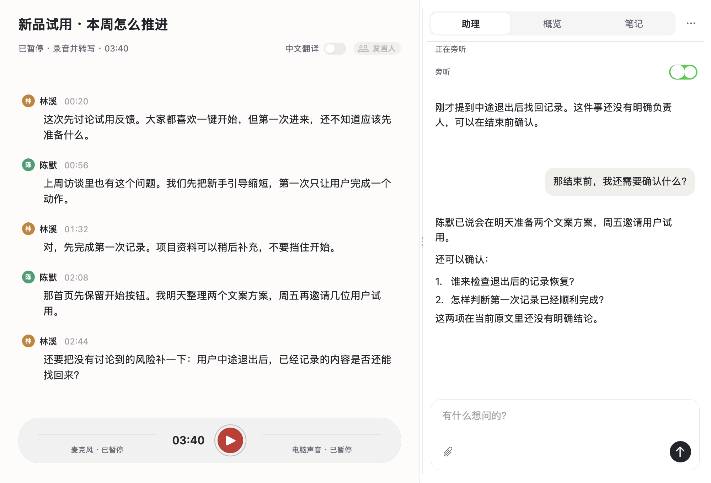
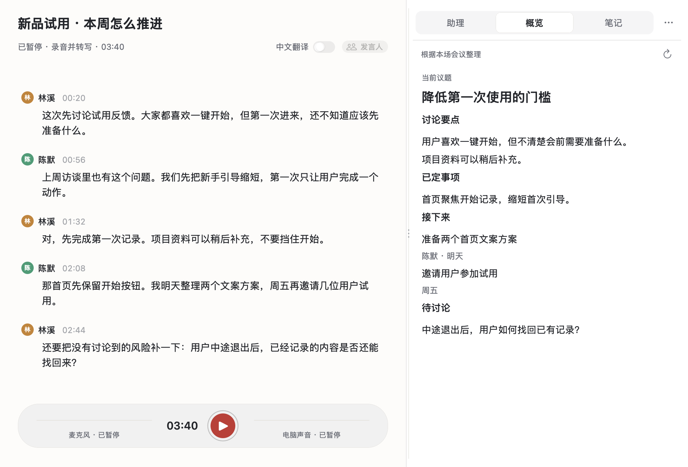

<p align="center">
  
</p>

<h1 align="center">在场 · Zaichang</h1>

<h3 align="center">让 AI 听见会议，也读懂你的项目。</h3>

<p align="center">给经常开项目会、做访谈的 Mac 用户。<br>留下现场原文，让 Codex 带着项目背景旁听；有问题，随时在同一场对话里追问。</p>

<p align="center">
  <a href="docs/AGENT_SETUP.md"><strong>让 Agent 帮我安装 →</strong></a>　·　
  <a href="docs/USAGE.md">看看怎么用</a>
</p>

<p align="center"><sub>Apple Silicon · macOS 15+ · 开源 MIT · 转写与 AI 使用你自己的服务账号</sub></p>



<p align="center"><sub>0.3.0 真实原生界面；人物、会议文字与助理回复为虚构的公开演示内容，不代表模型实测结果。</sub></p>

## 把项目背景，带进正在发生的讨论

“按上次方案推进。”会上这句话很短，背后可能是几份方案、一轮反馈和上周的约定。

告诉助理项目资料在哪里，它就能结合当前原文、笔记与可读取的文件，帮你核对变化、比较选择。你可以直接问：

> 结合项目文件，刚才的安排与原计划有哪些变化？

开启 **旁听** 后，助理根据新讨论与可用背景，自行判断何时提醒。你随时可以提问，提醒和回答都留在**同一个对话**里。会前准备的问题，开始录音后还可以接着聊。

旁听默认关闭。助理用于读取、分析和回答，不代发消息或修改文件。项目资料是可选增强；[安装时可以一起配置](docs/AGENT_SETUP.md#项目资料目录)。

## 讨论继续，已经说清的事也留得住

切到 **概览**，就能回看当前议题、明确决定、行动项与尚未解决的问题。概览依据本场原文在后台更新，切回助理或笔记后也会继续整理。



<p align="center"><sub>同一场公开示例的概览视图。概览、助理回复和自己的笔记分别保留。</sub></p>

**原文用来核对，助理用来讨论，笔记留给你自己的判断。** 会后导出的记录也保留这些区别。

## 微信里临时开的一场会，也能留下原文

在场从 Mac 的麦克风和电脑声音收音，边听边转写。记录入口在你手上，无需等别人发来逐字稿。

| 讨论发生在哪里 | 怎样使用在场 |
| --- | --- |
| Mac 上的微信语音、线上会议 | 收录电脑声音和自己的麦克风 |
| 线下面谈、用户访谈、课程 | 使用 Mac 麦克风或外接麦克风 |
| 手机通话或手机会议 | 手机打开外放，放在 Mac 附近收音 |

电脑声音会包含其他应用和通知；手机外放通过麦克风收音，效果取决于距离与环境。录音前请告知参与者，并确认有权记录和处理这些内容。

## 会后，带走能接着用的记录

- **原话可以回查。** 录音、原始记录与整理内容分别保留；发言人有误时可以核对、纠正。重新整理不会替代原始记录。
- **安排可以逐项核对。** 导出原文、笔记与助理提醒，或生成六部分纪要：概要、议题与结论、明确决定、明确待办、未决问题、关键原话。
- **背景可以一起参考。** 生成纪要时，可选择本地 PDF、TXT、Markdown 文件或文件夹。会议事实与承诺以本场原文为依据。

听英文会议时，还可以开启**逐句中文翻译**，对照原句阅读，并补译本场已有内容。

## 开始使用

**推荐让 Codex 或其他有本机终端能力的 Agent 帮你安装。** 把这句话交给它：

```text
帮我安装在场：https://github.com/JoeSangAI/zaichang
请先读取仓库的 docs/AGENT_SETUP.md，按教程检查环境、安装并验证。
```

1. **Agent 安装应用。** 检查 Mac 环境、下载依赖、构建并运行离线验收。当前提供源码安装，首次下载约 570 MB 依赖，构建与验收通常需要十几分钟。
2. **你连接自己的账号。** 转写、翻译和纪要使用百炼；助理与概览使用本机已登录的 Codex。百炼密钥由你自己在应用设置中填写。
3. **打开在场，开始一场讨论。** 首次录音按 macOS 提示授予权限。项目资料、术语表和声音记忆按需配置，稍后再加也可以。

Apple Silicon、macOS 15+；Python 3.12、Swift 6 和 Xcode Command Line Tools 由安装流程检查。暂不连接 AI 服务时，可以先用 **仅录音** 保存音频。

**[完整 Agent 安装教程 →](docs/AGENT_SETUP.md)**　[手动安装](docs/INSTALL.md)

## 记录在本机，在线能力由你选择

在场采用本机存储。**转写与 AI 功能会使用在线服务，费用或额度由你的服务账号承担。**

| 你开启的功能 | 数据去向 |
| --- | --- |
| 仅录音 | 音频保存在本机 |
| 录音并转写 | 音频发送给所配置的云端语音服务 |
| 整理、标题、翻译与纪要 | 所需音频片段或文字发送给百炼；纪要还使用笔记与手动选择的参考资料 |
| 助理、概览与旁听 | 所需会议文字及相关资料经本机 Codex 进入其模型服务 |
| 跨会议声音记忆 | 单独开启后保存在本机；人物结果支持人工纠正 |

助理历史保存在在场中，当前版本不会为每场会议向 Codex 会话列表添加新聊天。助理读取项目资料的范围取决于本机 Codex 权限。

[查看完整的数据、权限与删除说明 →](docs/PRIVACY.md)

---

**下一场项目会，让 AI 也在场。**　[让 Agent 帮我安装 →](docs/AGENT_SETUP.md)

[使用指南](docs/USAGE.md) · [更新记录](CHANGELOG.md) · [架构与数据流](docs/ARCHITECTURE.md) · [依赖与许可证](docs/DEPENDENCIES.md) · [MIT](LICENSE) · [反馈问题](https://github.com/JoeSangAI/zaichang/issues)

反馈时请附系统版本、操作步骤与错误提示，勿上传凭据、私人录音或未经脱敏的会议内容。
