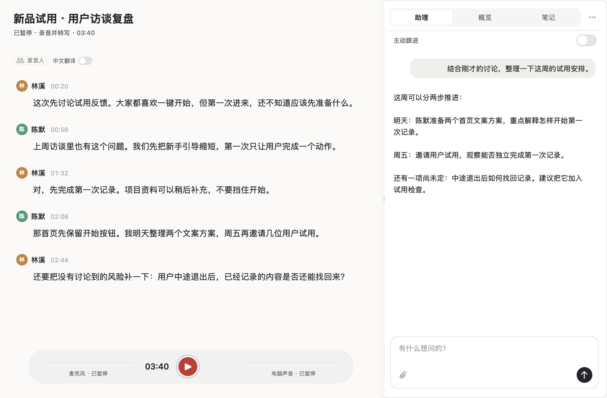
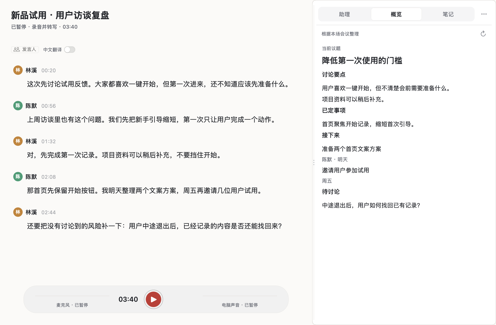

  

<h1 align="center">在场 · Zaichang</h1>

<strong>让 AI 听见会议，也读懂你的项目。</strong>

Mac 上的会议录音、实时原文与 Codex 助理。 微信通话、线上会议、手机外放——留下讨论原文，带着项目背景继续思考。

  <a href="docs/INSTALL.md"><strong>安装在场 →</strong></a> ·
  <a href="docs/USAGE.md">使用指南</a> ·
  <a href="docs/PRIVACY.md">数据与权限</a>

Apple Silicon · macOS 15+ · 自备转写服务凭据与 Codex 账号

真实应用界面；会议文字与助理回答均为公开演示示例。

## 那些没有逐字稿的讨论，也值得留下

微信里聊完了一件要紧事，挂断后只剩印象。手机会议开了外放，没人负责记录。线上会议结束了，你却拿不到完整原文。

在场从 Mac 的麦克风和电脑声音采集音频，边听边转写。记录跟着声音走，不依赖对方提供会议纪要或下载入口。

| 讨论发生在哪里 | 在场怎样记录 |
| --- | --- |
| Mac 上的微信语音、会议软件 | 同时采集电脑声音与自己的麦克风 |
| 手机通话或手机会议 | 打开手机外放，放在 Mac 附近，由 Mac 麦克风收音 |
| 线下面谈、访谈、课程 | 使用 Mac 麦克风或外接麦克风 |

当前新录音同时收录麦克风与全部电脑声音，包括其他应用和通知。手机外放的效果取决于距离、音量和环境噪声；它通过麦克风收音，不读取 iPhone 通话音轨。

## 讨论到哪，助理就能跟到哪

会议里的一句“按上次方案推进”，只有结合项目材料才有意义。在场把当前原文与笔记交给本机 Codex；告诉助理资料在哪里，它就能在已有权限内查阅背景，帮助你比较、追问和整理。

你可以直接问：

> “结合项目文件，刚才的安排与原计划有哪些变化？”  
> “这段讨论还有什么关键问题没有确认？”  
> “把已经明确的事项整理出来，附上对应原话。”

需要同时处理几件事时，助理可以拆成独立任务，分别显示进展。**主动跟进默认关闭**；开启后，助理会根据新讨论寻找值得查证的问题，以只读方式跟进。

助理通过本机 `codex app-server` 工作，使用该运行环境中可用的模型、Skills 与 MCP 配置。具体工具取决于你的 Codex 配置与权限，见[助理工作方式](docs/ARCHITECTURE.md#codex-助理)。

## 会前准备、会中追问、会后接着做

| 时刻 | 你可以做什么 |
| --- | --- |
| **会前** | 先打开助理，带着项目材料梳理问题；开始录音后，延续同一场对话 |
| **会中** | 看实时原文、随手记笔记，向助理提问；需要时开启主动跟进 |
| **会后** | 回看原文、核对人物，继续讨论，导出原文、会议纪要与笔记 |

**助理、概览、笔记各有一个标签页。** 助理用于来回讨论；概览整理本场会议已经说清的要点；笔记保留你自己写下的判断。侧栏宽度可以拖动调整。

概览标签的真实界面，使用示例会议内容。

## 原话留着，名字可以慢慢确认

人物识别保留“待确认”的空间。声音来自哪个应用，不等于是谁在说话；在场支持核对与纠正发言人，再把确认结果用于会议记录。跨会议声纹识别需要单独开启。

原文、AI 整理稿和个人笔记分别保留。你可以导出文字，带回自己的项目文件夹；重新整理的内容不会代替录音与原始记录。

听英文会议时，可在说话人栏旁开启**中文翻译**，对照原句阅读，也能补译本场已有内容。会后可生成六部分纪要：概要、议题与结论、明确决定、明确待办、未决问题、关键原话。生成时可选择本地 PDF、TXT、Markdown 文件或文件夹作为背景；会议事实与承诺仍以本场原文为依据。

## 开始使用

当前提供**从源码构建并自行安装**的路径。

1. 准备一台运行 **macOS 15 或更高版本的 Apple Silicon Mac**。
2. 按[安装指南](docs/INSTALL.md)准备构建环境与依赖，安装应用。
3. 配置自己的云端转写凭据；需要助理时，完成本机 Codex 登录。
4. 选择录音模式，按 macOS 提示授权麦克风与电脑声音，然后开始记录。

可以选择**仅录音**，先把音频保存在本机；选择**录音并转写**时，音频会发给所配置的云端语音服务。转写、原文整理、自动标题、翻译与纪要使用你自己的百炼服务；助理和概览使用 Codex。两类服务的费用或额度分别由你的账号承担。

**[查看完整安装步骤 →](docs/INSTALL.md)**

## 数据在哪里，什么会发到云端

| 内容 | 处理方式 |
| --- | --- |
| 录音、会议原文、笔记、人物修订 | 保存在本机应用数据目录 |
| 录音并转写 | 向配置的云端语音服务发送音频 |
| 原文整理、标题、翻译、纪要 | 向百炼发送所需音频片段或文字；纪要还包括笔记文字与手动选择的参考资料 |
| 助理、会议概览 | 将所需会议文字与上下文交给本机 Codex，再由 Codex 调用其模型服务 |
| 项目资料 | 助理按实际 Codex 权限查阅；读取的相关内容可能进入模型上下文 |
| 跨会议声纹 | 确认声音记忆用途后在本机保存，使用文件权限保护 |

在场采用本机存储，转写与 AI 功能需要相应的在线服务。录音前请告知参与者，并确认你有权记录和处理相关内容。详见[数据、权限与删除范围](docs/PRIVACY.md)。

## 深入了解

- [安装与配置](docs/INSTALL.md)
- [日常使用与常见问题](docs/USAGE.md)
- [架构与数据流](docs/ARCHITECTURE.md)
- [隐私与权限](docs/PRIVACY.md)
- [MIT 许可证](LICENSE) · [第三方依赖与许可证](docs/DEPENDENCIES.md)
- [反馈问题](https://github.com/JoeSangAI/zaichang/issues)

遇到问题时，附上 macOS 版本、芯片、操作步骤与错误提示即可；请勿上传凭据、私人录音或未经脱敏的会议内容。
