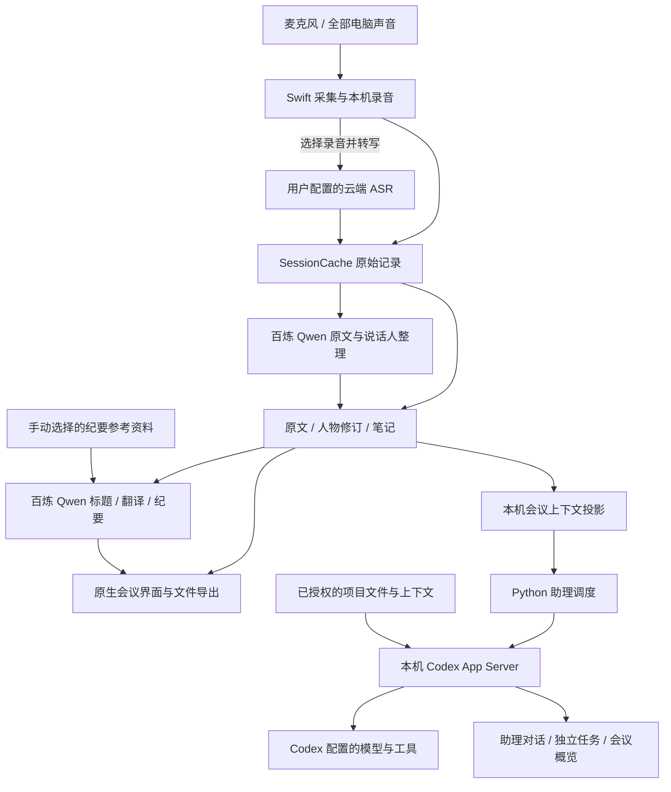

# 架构与数据流

在场由原生 macOS 界面与采集层、会议持久化层、本机 Codex 助理运行层组成。会议记录是事实来源；概览、人物识别建议和助理回答是基于这些记录生成的不同视图。

## 采集与记录

Swift 使用 macOS 音频接口采集麦克风与电脑声音，并按音轨持久化。音源标识用于区分输入，不作为人物身份。

录音与转写分别维护状态。录音在本机保存；选择云端转写后才进入 ASR 路径。应用按保存的进度恢复或重试未完成内容，不把网络连接成功视作整场转写完成。

人物处理包含本地说话人分段、识别建议与人工确认；原文与说话人整理另有云端 Qwen 路径，处理所需音频片段、转写、人物名单与术语提示。人工修订参与后续展示与导出。原始音频、转写事件与修订各有自己的持久化记录。

主要实现：`native/SourceCaptureSession.swift`、`native/MeetingCapture.swift`、`native/RecordingJournal.swift`、`native/IncrementalTranscript.swift`、`native/SpeakerPipeline.swift`。

## 会议数据与派生视图

`SessionCache` 保存会议原始记录。会议上下文投影供助理与只读插件消费，带有会话标识和修订信息；读取者需要绑定具体会议，避免把历史记录当成当前会议。

笔记与会议关联，支持文字和图片。原文、AI 整理稿、个人笔记分别导出；生成文件的更新会检查已有内容，避免静默覆盖用户在导出文件中做的修改。

主要实现：`native/MeetingAgentContext.swift`、`native/MeetingNotes.swift`、`native/MeetingFilesExport.swift`、`meeting_context.py`。

## Codex 助理

原生界面通过本机进程启动 `assistant_runtime.py`。它保存工作区与任务元数据，通过 `codex_runtime.py` 以 stdio JSON-RPC 连接 `codex app-server`。模型推理、工具调用、Codex 对话历史与原生审批由 Codex 运行环境提供。

本次接入验证使用 Codex CLI **0.163.0**；该版本的 `codex app-server --help` 将接口标记为 `[experimental]`。升级 Codex 后，需要重新验证助理接入与审批流程。

当前原生桥接以用户主目录作为 Codex 的工作目录。项目材料需要通过用户指示和实际文件访问找到；应用没有为每场会议建立独立的项目目录隔离。

| 任务类型 | 上下文与权限 |
| --- | --- |
| 用户主动对话 | 当前会议文字与笔记；`workspace-write`，审批策略 `on-request` |
| 主动观察与跟进 | 会议上下文及授权背景；`read-only`，默认未开启 |
| 会议概览 | 本场已完成转写；只读，生成指令禁止工具与外部上下文 |

`workspace-write` 允许在工作区范围内写入文件，并不表示每次写入都会弹窗。实际访问与审批由 Codex 的沙箱、配置和运行版本共同决定。命令与文件变更审批会传回应用界面；无法呈现的审批不会被静默同意。

助理通过动态任务工具建立、列出、继续或取消独立任务。调度器限制同时在途任务数量、主动任务数量与任务深度。任务与会议绑定，切换界面不会把它们重绑到另一场会议。

遇到连接中断时，运行层不会自动重放结果未知的请求，以免重复执行。重新连接后需读取已有状态和历史。

App Server 使用本机 Codex 可用的模型、Skills 与 MCP 配置。Codex 桌面产品中可见的连接器，不自动等同于这个进程可调用的工具。

主要实现：`native/MeetingAgentBridge.swift`、`native/MeetingAgentPanel.swift`、`assistant_runtime.py`、`codex_runtime.py`。

## 概览为何与助理分开

概览只从本场已完成的转写片段生成结构化结果，并验证来源引文和片段 ID。输入更新后，旧概览标记为待更新。助理可以使用项目背景与外部工具；这些研究结果不会直接混入概览，避免把讨论之外的判断写成会议已经达成的结论。

## 翻译、标题与导出纪要

英文转中文、自动标题和导出纪要直接调用百炼 `qwen-flash`，使用应用配置的用户凭据。原文与说话人整理由 `coarse_audio.py` 调用 Qwen 多模态模型。这些处理不经过 Codex App Server。

翻译按最终转写片段处理，并以片段 ID 与原文散列关联结果。开启时可补译已有英文片段；关闭时停止继续请求。译文随本场会议持久化，原始转写保留。

纪要生成时，界面读取最终转写、笔记文字及用户手动选择的 PDF/TXT/Markdown 参考资料，分别作为事实、重点提示与背景传入。输出固定六个字段，决定、待办与关键原话校验逐字原文依据，再保存为 Markdown；不追加笔记或参考资料原文。它与 Codex 概览是独立功能。

主要实现：`native/MeetingTranslation.swift`、`native/MeetingAutoTitle.swift`、`native/MeetingMinutes.swift`、`native/MeetingMinutesUI.swift`、`coarse_audio.py`。

## 外部 Agent 的只读入口

`agent-plugin/zaichang` 提供当前会议、分页读取、搜索和增量变化的工具。它读取本机会议投影，不控制录音，也不因会议中有人提出要求就执行动作。

本机插件与云端客户端之间需要另行建立连接。安装插件文件本身不代表云端客户端已经能访问这台 Mac。

## 验证入口

Python 回归位于 `tests/`，原生检查位于 `native/checks/`。`scripts/offline_check.py` 运行隔离检查；本机 Codex 在线调用另有显式验收入口，不属于离线检查。

构建与安装步骤见[安装指南](INSTALL.md)，数据发送范围见[隐私与权限](PRIVACY.md)。
