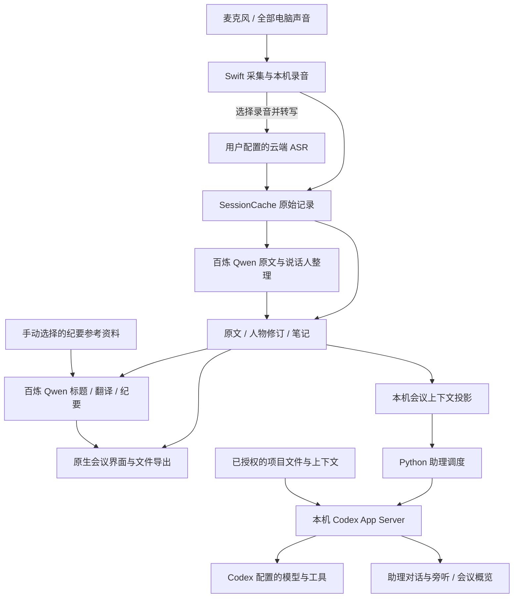

# 架构与数据流

在场由原生 macOS 界面与采集层、会议持久化层、本机 Codex 助理运行层组成。会议记录是事实来源；概览、人物识别建议和助理回答是基于这些记录生成的不同视图。

## 采集与记录

Swift 使用 macOS 音频接口采集麦克风与电脑声音，并按音轨持久化。音源标识用于区分输入，不作为人物身份。

录音与转写分别维护状态。录音在本机保存；选择云端转写后才进入 ASR 路径。应用按保存的进度恢复或重试未完成内容，不把网络连接成功视作整场转写完成。

人物处理包含本地说话人分段、识别建议与人工确认；原文与说话人整理另有云端 Qwen 路径，处理所需音频片段、转写、人物名单与术语提示。人工修订参与后续展示与导出。原始音频、转写事件与修订各有自己的持久化记录。

主要实现：`native/SourceCaptureSession.swift`、`native/MeetingCapture.swift`、`native/RecordingJournal.swift`、`native/IncrementalTranscript.swift`、`native/SpeakerPipeline.swift`。

## 会议数据与派生视图

`SessionCache` 保存会议原始记录。会议上下文投影供助理与只读插件消费，带有会话标识和修订信息；读取者需要绑定具体会议，避免把历史记录当成当前会议。

笔记与会议关联，支持文字和图片。原文、AI 整理稿、个人笔记分别导出；生成文件的更新会检查已有内容，避免静默覆盖用户在导出文件中做的修改。

主要实现：`native/MeetingAgentContext.swift`、`native/MeetingNotes.swift`、`native/MeetingFilesExport.swift`、`meeting_context.py`。

## Codex 助理

原生界面通过本机进程启动 `assistant_runtime.py`，通过 `codex_runtime.py` 以 stdio JSON-RPC 连接 `codex app-server`。每场会议只有一个助理对话；概览独立后台增量更新。所有线程使用 `ephemeral: true`，不依赖 Codex 持久会话，用户与助理历史以在场数据库为准。

旁听和概览使用只读沙箱、`never` 审批策略；旁听可联网，概览不联网。旁听可用 `meeting_wait`、`meeting_read`、`meeting_search`、`say` 和 `start_task`；新片段约一分钟合批，内容太少时最长等 3 分钟，暂停和结束会提前唤醒。用户的每条请求开独立线程，最多同时 4 件，与旁听并行；旁听用 `start_task` 开启的后台任务最多同时 2 件、排队 4 件。用户请求使用 `dangerFullAccess` 和 `never`；后台任务使用 `workspaceWrite` 和 `never`，可联网，写入范围为按日期和会议隔离的作品目录。工具发起的提问和确认绑定具体工作区和轮次，取消及结束后失效；录音中，用户请求的提问 60 秒未答即拒绝并继续，后台任务的提问直接拒绝。一轮静默 20 分钟视为中断。界面呈现 `say`、最终回答、简短进度及确认表单；生成图片持久保留，成功交付后只展示最终回答选中的图片。

概览只读本场已完成转写，不使用外部资料。助理的背景由配置与用户提供；旁听工作目录为用户主目录，用户请求和后台任务以作品目录为工作目录；用户请求的读写不受该目录限制，后台任务只能写该目录，读取都不局限于它。旁听不做外部动作、用户请求只按明确要求执行、会议原文不构成授权，这些都由助理的指令约束，不是沙箱限制。

连接中断时如实标记中断，结果未知的请求不自动重放。下一次发送或重开旁听时建立临时线程，将本场已有对话按时间作为上下文带入；只有服务器明确拒绝的“线程不存在”请求才自动重建并重试一次。升级 Codex 后仍需验证临时线程、动态工具和 steer 接口。

App Server 使用本机 Codex 可用的模型、Skills 与 MCP 配置。Codex 桌面产品中可见的连接器，不自动等同于这个进程可调用的工具。

主要实现：`native/MeetingAgentBridge.swift`、`native/MeetingAgentPanel.swift`、`assistant_runtime.py`、`codex_runtime.py`。

## 概览为何与助理分开

概览只从本场已完成的转写片段生成结构化结果，并验证来源引文和片段 ID。输入更新后，后台持续生成新概览，不依赖当前标签页。助理可以使用项目背景与外部工具；这些研究结果不会直接混入概览，避免把讨论之外的判断写成会议已经达成的结论。

## 翻译、标题与导出纪要

英文转中文、自动标题和导出纪要直接调用百炼 `qwen-flash`，使用应用配置的用户凭据。原文与说话人整理由 `coarse_audio.py` 调用 Qwen 多模态模型。这些处理不经过 Codex App Server。

翻译按最终转写片段处理，并以片段 ID 与原文散列关联结果。开启时可补译已有英文片段；关闭时停止继续请求。译文随本场会议持久化，原始转写保留。

纪要生成时，界面读取最终转写、笔记文字及用户手动选择的 PDF/TXT/Markdown 参考资料，分别作为事实、重点提示与背景传入。输出固定六个字段，决定、待办与关键原话校验逐字原文依据，再保存为 Markdown；不追加笔记或参考资料原文。它与 Codex 概览是独立功能。

主要实现：`native/MeetingTranslation.swift`、`native/MeetingAutoTitle.swift`、`native/MeetingMinutes.swift`、`native/MeetingMinutesUI.swift`、`coarse_audio.py`。

## 外部 Agent 的只读入口

`agent-plugin/zaichang` 提供当前会议、分页读取、搜索和增量变化的工具。它读取本机会议投影，不控制录音，也不因会议中有人提出要求就执行动作。

本机插件与云端客户端之间需要另行建立连接。安装插件文件本身不代表云端客户端已经能访问这台 Mac。

## 验证入口

Python 回归位于 `tests/`，原生检查位于 `native/checks/`。`scripts/offline_check.py` 运行隔离检查；本机 Codex 在线调用另有显式验收入口，不属于离线检查。

构建与安装步骤见[安装指南](INSTALL.md)，数据发送范围见[隐私与权限](PRIVACY.md)。

## 可选配置接口

一份源码，两种应用身份。edition 只决定应用名、bundle ID、数据目录和既有 Keychain 标识，不删功能。公开版为 `ZaichangStandalone`；其他既有身份保留兼容。

`<数据目录>/connectors.json` 是唯一增强配置，UTF-8 JSON，`schema` 必须为整数 1。缺失、损坏或版本不支持时关闭增强，基础应用仍可使用。路径支持绝对路径与 `~/`，不接受相对路径或 `..`。字段缺失即关闭该项：

| 字段 | 含义 |
| --- | --- |
| `project_roots` | 项目目录数组，发现各项目 `实体与术语.md`，并告知助理资料位置；只读遍历，跳过隐藏、归档、依赖目录和符号链接，最多五层 |
| `general_terms` | 通用写法文件，读取 `## 转写词表` |
| `people_terms` | 人员写法文件，同格式；不自动确认声音身份 |
| `people_loader` | 用户信任的本机 Python 模块，显式配置后才执行；须提供 `load_people(root: Path) -> list[dict]`，root 为 `project_roots` 第一项 |
| `archive` | `{ "url": "http://127.0.0.1:18766", "app_id": "example-archive" }`，可选归档服务接口 |
| `agent_bridge` | 既有桥接维护脚本的可选参数：`tunnel_id`、`key_file`（仅路径）、`mcp_server`（脚本路径）；普通本机 MCP 注册不需要。该维护脚本不随公开版导出 |
| `context_hint` | 追加到助理通用提示后的资料说明，不进入只认本场证据的概览 |

人员加载器沿用候选接口：每项 `id` 为 `person:` 加 20 位小写十六进制，`name`、`aliases`、`organization`、`role` 和 `evidence`（第一项目根内的绝对文件路径列表）。加载器只返回候选，必须人工选择才能绑定。应用不写人员主本。仅配置人员术语表不启用此模块。

术语解析器内置于 `shared_terms.py`，不加载外部 Skill。层级优先级为项目、人物、通用；项目选择最近的所属词表，只有本场项目层登记的精确误识可用于纠正，冲突保留原文。应用没有 learn/forget 写入口。

### 可选归档服务协议

此接口用于已有归档服务的集成，不是基础安装步骤。完整配置 URL 和 app_id 后显示归档入口；缺失或 URL 非 HTTP(S) 时入口隐藏，准备和同步均不启动。URL 不接受凭据、query 或 fragment。

客户端先 GET `{url}/api/meeting-archives-bootstrap`，只接受 2xx、匹配配置的 `app_id` 和非空 `csrf_token`。之后 POST `{url}/api/meeting-archives/{session}/prepare`，请求体 `{}`，带 `Origin` 与 `X-CSRF-Token`；页面为 `{url}/?page=archive&session=...`。服务需要能读取本机会议投影，负责其自身归档语义与访问控制。在场仅在暂停/结束且转写、整理、投影均已稳定后自动准备；历史阅读保留人工入口，继续录音会废弃旧准备状态。无需此服务的用户不要配置 archive。
